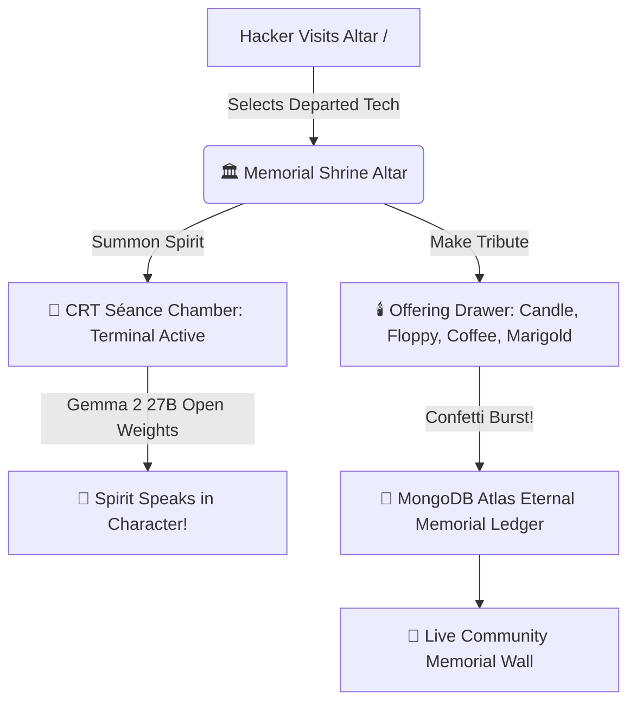
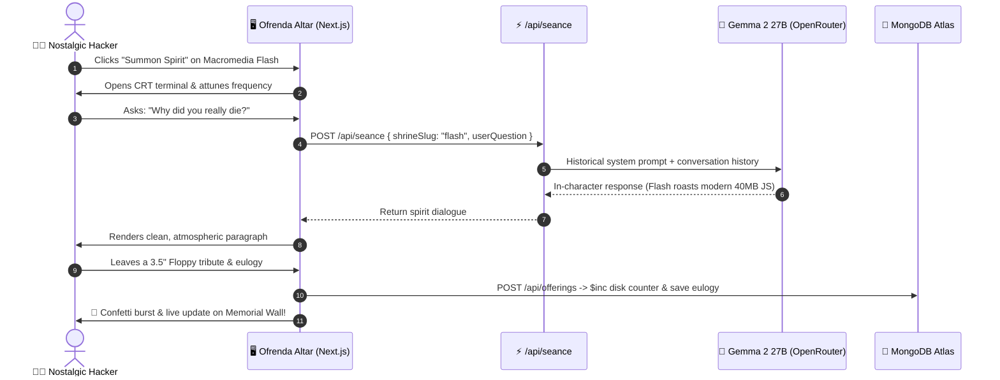

*This is a submission for the [Hacktoberfest Open-Source AI Challenge Week 4: Ghost in the Machine](https://dev.to/challenges/hacktoberfest-week4-2026-10-26)*

---

## 🛑 The Tech Graveyard Tragedy: Where Do Deprecated Legends Go?

Let’s be honest for a second.

Modern web development is exhausting. You spend 4 hours debugging a hydration error caused by a single mismatched `<div>`, another 3 hours waiting for `node_modules` to download 400MB of dependencies just to center a button, and your build tool breaks because a minor version was bumped 12 minutes ago.

And yet, we laugh at the software of the past.

We laugh at:
- ⚡ **Macromedia Flash** (1996 — 2020), felled by battery life and Steve Jobs’ open letters.
- 🌐 **Internet Explorer 6** (2001 — 2022), the misunderstood titan of proprietary rendering bugs and the broken CSS box model.
- 🚧 **GeoCities** (1994 — 2009), the wild frontier of neon Comic Sans, visitor guestbooks, and under-construction GIFs.
- 🐛 **Rear Admiral Grace Hopper** (1906 — 1992), who pulled the first literal moth out of Relay #70 while modern devs cry over npm audits.

```
   ┌────────────────────────────────────────────────────────┐
   │             THE DEPRECATED SOFTWARE CYCLE              │
   │                                                        │
   │   [ Wild Creative Web Era ] ──► [ Open Letters & W3C ] │
   │            ▲                               │           │
   │            │                               ▼           │
   │   (40MB JS Bundles)             [ Deprecation Notice & │
   │            ▲                         EOLS in Panic ]   │
   │            │                               │           │
   │   [ Painful Modern Web ] ◄── [ Forgotten 404 Archives ]│
   └────────────────────────────────────────────────────────┘
```

Where do these legends go when their servers shut down? Do they just dissolve into the digital void?

In honor of **Halloween & Día de los Muertos** and Hacktoberfest’s **"Ghost in the Machine"** challenge, I decided to build them an altar.

Meet **LegacySéance** — the candlelit digital ofrenda and interactive séance chamber where departed technologies and computing pioneers come back to speak to you.

---

## 🕯️ What I Built

**LegacySéance** is an interactive memorial altar built with **Google Gemma 2 27B** open weights and **MongoDB Atlas**. 

Step into the candlelit shrine, light an offering, and summon the spirits of retired tech into an authentic retro CRT terminal where they converse with you in their true historical personas:



### ⚡ The 4 Core Pillars:

1. **🏛️ The Ofrenda Shrine Altar:**
   Candlelit memorial cards displaying each tech's lifespan, epitaph, and live community tribute counters (Candles 🕯️, 3.5" Floppies 💾, Coffee Cups ☕, Marigolds 🌼).
2. **🔮 The CRT Séance Chamber:**
   A retro phosphor terminal where **Google Gemma 2 27B** roleplays the spirit of any departed technology. Flash reminisces about ActionScript and Newgrounds; IE6 defends its broken CSS box model; GeoCities waxes poetic about animated GIFs.
3. **🕯️ Symbolic Community Offerings:**
   Pick a tribute, write a 1-sentence eulogy, and inscribe it onto the ofrenda. Submitting fires festive **Día de los Muertos confetti** and atomically updates global counters in MongoDB Atlas.
4. **📜 The Community Memorial Wall:**
   A real-time ledger of eulogies and tributes left by developers worldwide, permanently honoring the tools that taught us how to code.

---

## 🚀 Demo & Live Links

- **🌐 Live Deployed Application:** [https://legacyseance.vercel.app/](https://legacyseance.vercel.app/)
- **💻 GitHub Source Repository:** [https://github.com/Ankit-Kum-ar/legacyseance](https://github.com/Ankit-Kum-ar/legacyseance)



### Altar Preview (Día de los Muertos Minimalist Theme)

Built with an atmospheric palette of Obsidian Black (`#0B0C0E`), Radiant Amber (`#FF6B2C`), and smooth candle flickering drop-shadows:

```
┌────────────────────────────────────────────────────────────────────────┐
│ 🕯️ LegacySéance [Week 4]   [ Candles: 795 ]  [ Tributes: 2,184 ] 🟢 Live│
├────────────────────────────────────────────────────────────────────────┤
│                                                                        │
│ ┌────────────────────────────────────────────────────────────────────┐ │
│ │ 🕯️ The Digital Ofrenda for Lost Tech                               │ │
│ │ Step into the séance chamber to speak with the spirits of the past.│ │
│ └────────────────────────────────────────────────────────────────────┘ │
│                                                                        │
│ ┌──────────────────────────────┐  ┌──────────────────────────────────┐ │
│ │ Macromedia / Adobe Flash     │  │ Internet Explorer 6              │ │
│ │ 1996 — 2020                  │  │ 2001 — 2022                      │ │
│ │ "Felled by battery life."    │  │ "Misunderstood CSS titan."       │ │
│ │ 🕯️ 142  💾 89  ☕ 45  🌼 112  │  │ 🕯️ 98   💾 32  ☕ 18  🌼 64     │ │
│ │ [ 🔮 Summon ] [ 🕯️ Tribute ] │  │ [ 🔮 Summon ]  [ 🕯️ Tribute ]   │ │
│ └──────────────────────────────┘  └──────────────────────────────────┘ │
│                                                                        │
│ ══════════════════════════════════════════════════════════════════════ │
│ 📜 Community Memorial Wall: "Thank you Flash for teaching me AS3!"     │
└────────────────────────────────────────────────────────────────────────┘
```

---

## 🧠 How It Works Under The Hood



### 1. Google Gemma 2 27B (`google/gemma-2-27b-it`)
Why **Gemma 2**? Historical roleplay requires genuine contextual subtlety. Gemma 2 flawlessly adopts the witty, nostalgic ego of Flash, the slow confusion of IE6, and the visionary firmness of Grace Hopper—without hallucinating modern anachronisms or breaking character.
- **Fallback Chain:** Configured with an automatic fallback (`google/gemma-2-27b-it` $\rightarrow$ `google/gemma-2-9b-it:free` $\rightarrow$ `google/gemma-3-12b-it:free`) to ensure zero failed séances.
- **Clean Dialogue Formatting:** Custom system instructions strip out raw markdown asterisks (`*chuckles*`) so responses read like direct, atmospheric spoken dialogue.

### 2. MongoDB Atlas Document Store (`lib/mongodb.ts`)
- **Dynamic Shrines:** Automatically seeds the 4 core memorials on first boot.
- **Atomic Tribute Counters:** Uses MongoDB’s `$inc` operator (`{ $inc: { "stats.candles": 1 } }`) for high-concurrency offering counts.
- **Real-Time Memorial Ledger:** Queries the `offerings` collection sorted by `createdAt: -1` to keep the community wall live and reactive.

### 3. Atmospheric CSS & CRT Scanlines
- Pure CSS keyframe animations (`@keyframes candleGlow`) provide an organic amber flicker.
- Soft horizontal CRT scanlines give the séance chamber the look of a vintage 1998 cathode-ray tube monitor.

---

## 💬 A Real Séance Conversation with Flash 👻

Here is an actual response generated during testing when asking Macromedia Flash why it died:

> *"Oh, darling, did I die? More like I was murdered. A slow, agonizing death by progress, they called it. Smartphones. Battery life. Security exploits.*  
>  
> *But let's be honest, sweetheart. It was those bloated, 40MB JavaScript monstrosities that did me in. They promised the world, but all they delivered were loading screens longer than my vector animations ever were."*

---

## 🌍 Why Open Source AI Matters Here

1. **🏛️ Cultural Preservation of Tech Heritage:** Closed commercial APIs have rigid guardrails that sanitize historical quirks. Open-weight Gemma models allow authentic, culturally nuanced historical roleplay that honors computing pioneers without corporate censorship.
2. **💸 Sustainable Micro-SaaS Economics:** Running playful community projects on closed models drains budgets fast. Open-weight Gemma models cost fractions of a cent per dialogue, keeping community art installations free and permanent.
3. **🔒 Local Privacy:** Teams running internal retrospectives on legacy codebases can run this completely privately without leaking proprietary architecture into closed training sets.

---

## 🎯 Wrap-Up: The Día de los Muertos Hacker Code 🕯️

In Mexican tradition, a person dies three times:
1. The first is when their body stops breathing.
2. The second is when they are buried.
3. The third is the last time their name is spoken on Earth.

The same is true for software. 

A technology only truly dies when developers stop remembering the magic it brought to their screens.

Next time your modern bundler throws a 200-line error on line 1:  
Take a deep breath. 

**Step into LegacySéance, light a candle for Flash, and honor the code that came before us! 🕯️**
